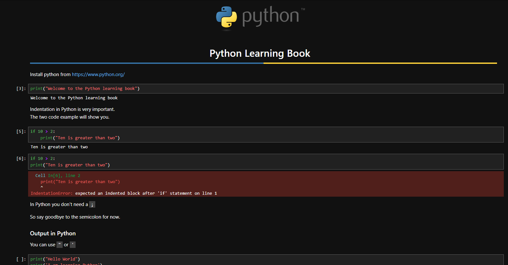

# Python Learning

<p align="center">
  
  
  
  
</p>

<p align="center">
  
</p>




A collection of **Python learning notes, examples, exercises, and projects**, created primarily with Jupyter notebooks.

## Repository Structure

```text
Python_learning/
│
├── Basics.ipynb
├── Examples.ipynb
├── OOP.ipynb
└── README.md
```

| Notebook           | Description                                                                                |
| ------------------ | ------------------------------------------------------------------------------------------ |
| **Basics.ipynb**   | Python fundamentals, syntax, variables, data types, conditions, loops, functions, and more |
| **Examples.ipynb** | Practical examples and smaller exercises for applying Python concepts                      |
| **OOP.ipynb**      | Object oriented programming concepts such as classes, objects, attributes, and methods     |

The repository will grow as I continue learning Python.

## About Jupyter

[Jupyter](https://jupyter.org/) is an interactive environment for working with **code, documentation, data, and visualizations** in the same document.

The main format used in this repository is the **Jupyter Notebook (`.ipynb`)**.

A notebook consists of individual cells that can contain:

* Python code
* Markdown text
* mathematical expressions
* tables
* visualizations
* output generated by the code

This makes Jupyter notebooks especially useful for learning because concepts can be explained and demonstrated directly alongside the code.

## Python, Jupyter, JupyterLab & Anaconda

These terms are related, but they are not the same thing:

| What                 | Purpose                                                                        |
| -------------------- | ------------------------------------------------------------------------------ |
| **Python**           | Programming language used in this repository                                   |
| **Jupyter Notebook** | Interactive document format (`.ipynb`)                                         |
| **JupyterLab**       | Application for creating and working with Jupyter notebooks                    |
| **Anaconda**         | Python distribution with tools for managing Python, environments, and packages |
| **VS Code**          | Alternative code editor that can run Jupyter notebooks                         |

> **Python is the programming language used in this repository. Jupyter Notebook is the document format, while JupyterLab is one application used to work with these notebooks. Anaconda provides Python and tools for managing the environment and packages.**

## Getting Started

There are several ways to work with the notebooks in this repository.

### Option 1 JupyterLab with Anaconda

I use **JupyterLab through Anaconda**.

Anaconda provides Python, JupyterLab, and tools for managing Python packages and environments.

1. Download and install [Anaconda](https://www.anaconda.com/download).
2. Open **Anaconda Navigator**.
3. Launch **JupyterLab**.
4. Open the `Python_Learning` folder.
5. Open one of the `.ipynb` files.

You can then execute the individual cells and follow the examples directly in the notebook.

### Option 2 JupyterLab without Anaconda

JupyterLab can also be installed independently if Python is already installed.

Install JupyterLab with:

```bash
pip install jupyterlab
```

Then start JupyterLab:

```bash
jupyter lab
```

### Option 3 VS Code

[Jupyter notebooks](https://code.visualstudio.com/docs/datascience/jupyter-notebooks) can also be opened and executed directly in **VS Code**.

This is a good alternative if you already use VS Code for programming.

## How Notebooks Work

A Jupyter notebook is divided into **cells**.

### Code Cells

Code cells contain executable Python code:

```python
name = "Mel"
print(name)
```

When the cell is executed, the result appears directly below it.

### Markdown Cells

Markdown cells are used to explain concepts, document the learning process, create headings and tables, or describe results.

For example:

```markdown
## Variables

A variable stores a value that can be used later in a program.
```

### Typical Workflow

A notebook can combine explanation, code, and results:

```text
Markdown cell
      ↓
Explain a concept
      ↓
Code cell
      ↓
Run the example
      ↓
Output
      ↓
Markdown cell
      ↓
Explain the result
```

This makes a Jupyter notebook both **executable code and documentation**.
